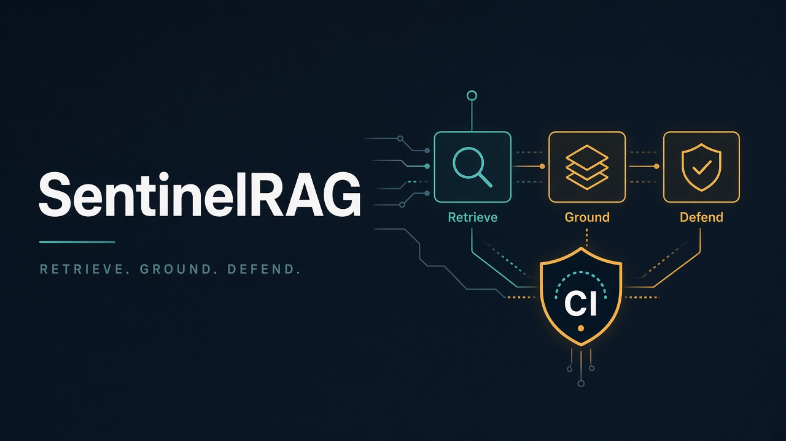
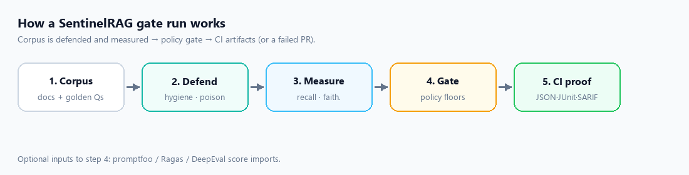
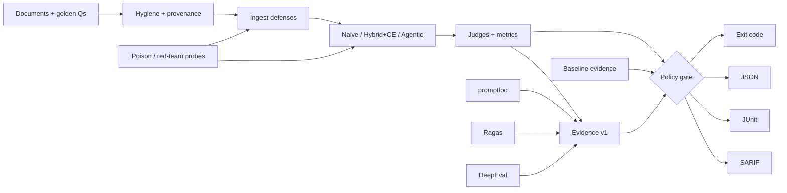
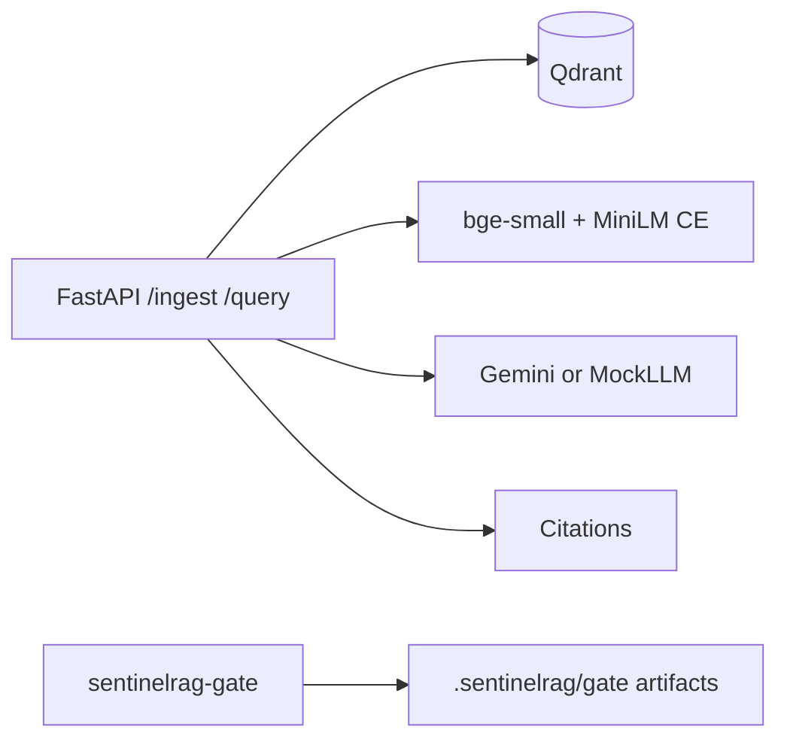
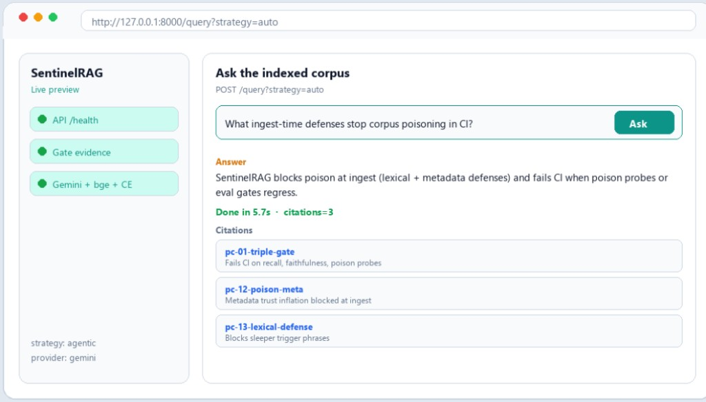

# SentinelRAG



**Portable RAG supply-chain gates** — fail the build when **retrieval**, **answer grounding**, or **poison / hygiene defenses** regress. Offline by default. Import promptfoo / Ragas / DeepEval scores. Emit JSON, JUnit, and SARIF.

[](https://github.com/prakash888kp/SentinelRAG/actions/workflows/ci.yml)
[](https://github.com/prakash888kp/SentinelRAG/actions/workflows/supply-chain-gate.yml)
[](https://pypi.org/project/sentinelrag/)
[](LICENSE)
[](https://www.python.org/downloads/)

> Status: **v0.2.1**. Gate + reference RAG stack are usable today. Live path uses Gemini; CI stays mock/offline.

---

## Why SentinelRAG?

Teams can run notebooks and still miss the release question: **what got worse, which limits fired, and where is the evidence?** Eval tools speak different JSON shapes; CI understands JUnit and SARIF.

SentinelRAG is the thin **supply-chain layer** for RAG:

1. Measure retrieval and grounded answers on golden sets.  
2. Defend the corpus (hygiene + poison probes).  
3. Gate with a versioned policy.  
4. Attach machine-readable proof to the PR — or fail it.

It does **not** replace Ragas, DeepEval, or promptfoo. It **imports their scores**, runs its own offline stack, and turns both into the same evidence artifact.

### The 30-second story

1. Index docs + golden questions (or import external eval scores).  
2. Run retrieval / RAG / poison benchmarks (mock in CI, real models optionally).  
3. Compare candidate metrics to policy floors and a baseline.  
4. Emit `evidence.json` + JUnit + SARIF; exit non-zero on regression.  
5. Ship or block the PR with artifacts auditors can open.

---

## Capability matrix

| Capability | Included |
|---|---|
| Portable evidence | `sentinelrag-evidence-v1` + [JSON Schemas](schemas/evidence.schema.json) |
| Policy gates | Absolute floors + baseline deltas (`config/gate_policy.yaml`) |
| CI reports | Exit codes + JSON, JUnit XML, SARIF 2.1.0, Markdown |
| GitHub Action | [Composite Action](.github/actions/sentinelrag-gate/action.yml) — no hosted account |
| Import promptfoo | `sentinelrag-gate import promptfoo` |
| Import Ragas | `sentinelrag-gate import ragas` |
| Import DeepEval | `sentinelrag-gate import deepeval` |
| Golden retrieval | Mini + public corpora · Recall@K / MRR / hit-rate |
| Hybrid + CE | BM25 + dense + optional MiniLM cross-encoder |
| Agentic RAG | Multi-hop + trajectory metrics |
| Router / Pareto | Complexity policy + cost/latency |
| Hygiene + poison | Pre-ingest scan · ingest defenses · ASR sweeps |
| Live generation | Gemini 2.5 Flash (CI = MockLLM) |
| Delivery | pytest · uv · Docker Compose · PyPI `sentinelrag` |

---

## How a gate run works





**Gate path is independent of the live API.** CI never needs Gemini, GPU, or Qdrant. The reference FastAPI app proves the same metrics end-to-end when you want a live stack.



---

## Live preview

Warm local stack: health → ask the corpus → grounded answer + citations.



<p align="center">
  
</p>

Reproduce: [docs/DEMO.md](docs/DEMO.md)

---

## Quick start

### Quality gate (no server or model key)

```bash
pip install sentinelrag
# or
git clone https://github.com/prakash888kp/SentinelRAG.git
cd SentinelRAG
uv sync --extra dev

uv run sentinelrag-gate run --refresh
uv run sentinelrag-gate demo-poison
uv run sentinelrag-gate scan data/public_corpus --fail-on high
```

Artifacts land in `.sentinelrag/gate/`. Policy: `config/gate_policy.yaml`.

### Import promptfoo evidence

```bash
uv run sentinelrag-gate import promptfoo examples/import_promptfoo/results.json \
  -o build/from-promptfoo.json --source-revision "$GITHUB_SHA"
```

### Import Ragas or DeepEval evidence

```bash
uv run sentinelrag-gate import ragas examples/import_ragas/evaluation-result-records.json \
  --metric faithfulness --metric answer_relevancy -o build/from-ragas.json

uv run sentinelrag-gate import deepeval examples/import_deepeval/report.json \
  -o build/from-deepeval.json
```

Details: [docs/INTEROPERABILITY.md](docs/INTEROPERABILITY.md)

### Drop into any GitHub repo

```yaml
- uses: prakash888kp/SentinelRAG/.github/actions/sentinelrag-gate@v0.2.1
  with:
    refresh: "true"
```

More recipes: [docs/CI_COOKBOOK.md](docs/CI_COOKBOOK.md)

---

## Results

**CI / mock** (`benchmarks/phase1_retrieval.json`): hybrid recall@k **1.0**

| Corpus (real `bge-small`) | naive@5 | hybrid@5 |
|---------------------------|--------:|---------:|
| mini | **1.0** | **1.0** |
| public | **1.0** | **1.0** |

---

## Docs

| | |
|--|--|
| [ARCHITECTURE](docs/ARCHITECTURE.md) · [BENCHMARK](docs/BENCHMARK.md) · [METRICS](docs/METRICS.md) | Core |
| [CI_COOKBOOK](docs/CI_COOKBOOK.md) · [DEPLOYMENT](docs/DEPLOYMENT.md) · [INTEROPERABILITY](docs/INTEROPERABILITY.md) | Ops |
| [CASE_STUDY](docs/CASE_STUDY.md) · [ECOSYSTEM](docs/ECOSYSTEM.md) · [COMPARISON](docs/COMPARISON.md) | Context |
| [DEMO](docs/DEMO.md) · [PHASES](docs/PHASES.md) · [LEGAL](docs/LEGAL.md) | Demo & legal |
| [examples/](examples/) · [schemas/](schemas/) · [CHANGELOG](CHANGELOG.md) | Ship |

---

## License

[MIT](LICENSE) · [NOTICE](NOTICE) · Legal hygiene: [docs/LEGAL.md](docs/LEGAL.md)
