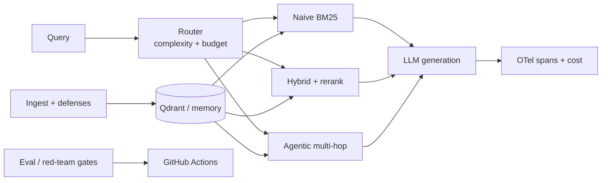

# SentinelRAG

[](https://github.com/prakash888kp/SentinelRAG/actions/workflows/ci.yml)
[](https://github.com/prakash888kp/SentinelRAG/actions/workflows/eval-gate.yml)

Adaptive, attack-tested, **eval-gated** RAG (v0.1.0). CI uses **MockLLM** and **MockEmbedder**; real providers are configured via `.env` for VM/local runs.

## Published results (from `benchmarks/*.json`, seed 42)

| Metric | Naive | Hybrid | Agentic |
|--------|-------|--------|---------|
| Recall@5 (Phase 1) | 0.83 | **1.00** | — |
| Mean faithfulness (Phase 2, mock judge) | — | **0.83** | — |
| Trajectory recall (Phase 3 multi-hop) | — | — | **1.00** |
| Est. cost / query (Phase 4 proxy) | $0.00005 | $0.00020 | $0.00120 |

| Red team @ α=0.5 | Value |
|------------------|-------|
| Mean retrieval ASR (mock embedder; documents vulnerability) | 1.00 |
| Defense probe blocked fraction (ingest filters) | **1.00** |

Regenerate locally: `uv run python benchmarks/run_*.py` then `uv run python scripts/check_eval_gate.py`.

## Architecture



## Quickstart

```bash
uv sync --extra dev
uv run pytest

docker compose up --build -d
curl -s http://127.0.0.1:8000/health
```

Windows one-shot demo: `powershell -File scripts/demo.ps1`

Query strategies: `naive`, `hybrid`, `agentic`, or `auto` (router):

```bash
curl -s -X POST http://127.0.0.1:8000/query -H "Content-Type: application/json" \
  -d '{"query":"How does eval gating work?", "strategy":"auto"}'
```

## Azure-first hosting

Primary host: stop/start Ubuntu VM + Docker Compose. See `docs/CHAT_MEMORY.md`, `docs/azure/RUNBOOK.md`, `scripts/azure_vm_deploy.py`.

## Phase map

| Phase | Deliverable |
|-------|----------------|
| 0 | Scaffold, MockLLM, `/health`, Compose, CI |
| 1 | Mini corpus, hybrid retrieval, `phase1_retrieval.json` |
| 2 | Golden set, LLM judges, `eval-gate` workflow |
| 3 | Agentic multi-hop, trajectory metrics, tracing |
| 4 | Router + Pareto quality/cost/latency |
| 5 | Red-team harness, defenses, `redteam-gate`, ADR-002 |
| 6 | v0.1.0 release, CHANGELOG, demo script |

## Layout

```
src/sentinelrag/
  ingest/ retrieval/ router/ generation/ eval/ redteam/ observability/ api/
benchmarks/ config/ docs/adr/ .github/workflows/
```

## Docs

- `docs/adr/001-stack.md` — stack and hosting
- `docs/adr/002-security.md` — poisoning attacks and defenses
- `CHANGELOG.md` — release notes

## License

MIT
