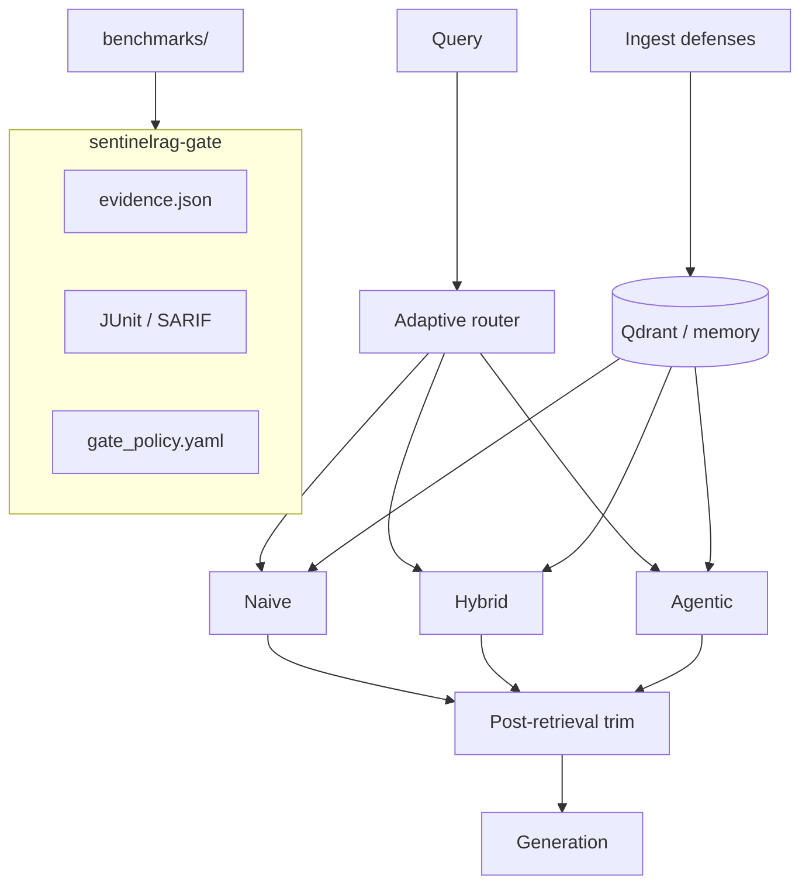

# SentinelRAG

[](https://github.com/prakash888kp/SentinelRAG/actions/workflows/ci.yml)
[](https://github.com/prakash888kp/SentinelRAG/actions/workflows/supply-chain-gate.yml)
[](https://github.com/prakash888kp/SentinelRAG/actions/workflows/eval-gate.yml)
[](https://github.com/prakash888kp/SentinelRAG/actions/workflows/redteam-gate.yml)

**RAG supply-chain CI** — one gate for **retrieval**, **grounded answers**, and **poison defenses**,
plus adaptive routing in a forkable FastAPI + Qdrant reference app.

**Author:** PRAKASH KUMAR K ([@prakash888kp](https://github.com/prakash888kp)) · **PyPI:** `prakash888kp` · **Support:** [GitHub Issues](https://github.com/prakash888kp/SentinelRAG/issues)

Read the narrative: **[docs/STORY.md](docs/STORY.md)**

---

## The hook in one command

```bash
uv sync --extra dev
uv run sentinelrag-gate run --refresh
```

Writes audit artifacts to `.sentinelrag/gate/`:

| Output | Purpose |
|--------|---------|
| `evidence.json` | Versioned metric bundle (`sentinelrag-evidence-v1`) |
| `junit.xml` | CI test reporting |
| `sarif.json` | Security dashboard ingestion |
| `summary.md` | Human-readable PR summary |

Policy as code: `config/gate_policy.yaml` (absolute thresholds + regression vs `benchmarks/baseline_evidence.json`).

---

## Why developers search for this

Most RAG repos help you **build**. SentinelRAG helps you **not ship regressions** — including **poisoning bypasses** — with evidence auditors recognize.

| Layer | What fails CI |
|-------|----------------|
| Retrieval | Hybrid recall / MRR (`phase1`, public corpus) |
| Answers | Faithfulness / relevance judges (`phase2`) |
| Ingest security | Poison defense probes (`redteam`) |
| Post-retrieval | Trim + **Poison benchmark v1** |
| Regression | Drops vs anchored baseline |

Security control mapping: [docs/OWASP_RAG_CI_MAP.md](docs/OWASP_RAG_CI_MAP.md)

---

## Poison story (60 seconds)

```bash
uv run sentinelrag-gate demo-poison
```

Shows ingest blocks, raw retrieval ASR, and post-retrieval trim — the demo link for security-minded teams.

---

## Architecture



---

## Add to any repo (composite Action)

```yaml
- uses: prakash888kp/SentinelRAG/.github/actions/sentinelrag-gate@master
  with:
    policy: config/gate_policy.yaml
    refresh: "true"
```

Or wire your own stack via `examples/adapter_template.py` (`collect_metrics()`).

---

## Quickstart (no API keys)

```bash
git clone https://github.com/prakash888kp/SentinelRAG.git
cd SentinelRAG
cp .env.example .env
uv run pytest
docker compose up --build -d
```

### PyPI

```bash
pip install sentinelrag
sentinelrag-gate run --refresh
```

Publish steps: [docs/PUBLISHING.md](docs/PUBLISHING.md) (maintainer: **prakash888kp**).

---

## Results (mock embedder, seed 42)

See committed `benchmarks/*.json` — hybrid recall **1.0** on mini + public corpora; poison v1 in [docs/POISON_BENCHMARK_v1.md](docs/POISON_BENCHMARK_v1.md).

---

## All-in-one layout

```
sentinelrag-gate      # CLI — collect | run | compare | demo-poison
src/sentinelrag/gate/ # evidence, policy, SARIF/JUnit, adapter
data/public_corpus/   # 20-doc OSS sample
data/golden.jsonl       # portable golden set
config/gate_policy.yaml
```

Docs: [CONTRIBUTING.md](CONTRIBUTING.md) · [SECURITY.md](SECURITY.md) · [CHANGELOG.md](CHANGELOG.md) · [docs/COMPARISON.md](docs/COMPARISON.md)

---

## License

MIT — see [LICENSE](LICENSE).
