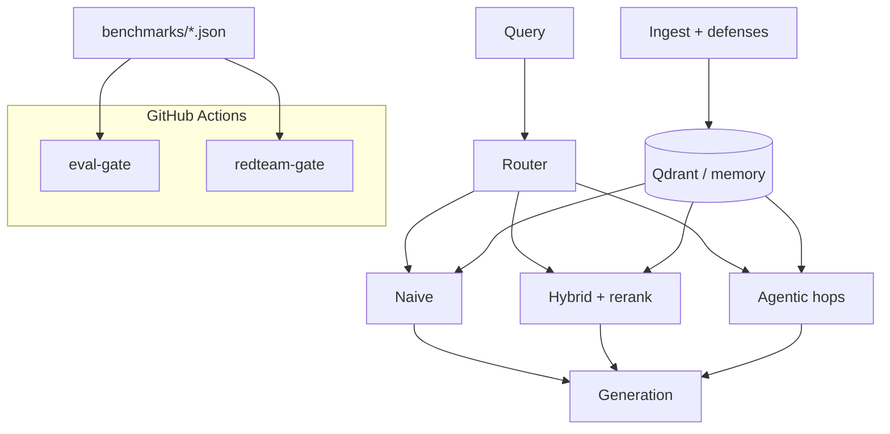

# SentinelRAG

[](https://github.com/prakash888kp/SentinelRAG/actions/workflows/ci.yml)
[](https://github.com/prakash888kp/SentinelRAG/actions/workflows/eval-gate.yml)
[](https://github.com/prakash888kp/SentinelRAG/actions/workflows/redteam-gate.yml)

**Triple-gate adaptive RAG** — fail CI on **retrieval**, **answer quality**, or **ingest-time poison
defenses**, with naive / hybrid / agentic routing in one forkable service.

> Most RAG repos help you *build*. SentinelRAG helps you **not ship regressions** — including
> poisoning bypasses — while still routing by cost and complexity.

**Author:** PRAKASH KUMAR K ([@prakash888kp](https://github.com/prakash888kp)) · **Support:** [GitHub Issues](https://github.com/prakash888kp/SentinelRAG/issues) only

---

## Why this exists

| Gate | What breaks the build |
|------|------------------------|
| **Retrieval** | Hybrid recall@k / MRR below thresholds (`eval-gate`) |
| **Generation** | Faithfulness / relevance judge regressions (`eval-gate`) |
| **Security** | Ingest poison-defense probes fail (`redteam-gate`) |

Eval-only tools (RAGAS, rag-ci, raggate) focus on metrics. Frameworks (LangChain, LlamaIndex) focus
on glue. **SentinelRAG combines a small reference stack with three gates** — see
[docs/COMPARISON.md](docs/COMPARISON.md).



---

## Results (reproducible, mock embedder, seed 42)

### Mini corpus (CI)

| Strategy | recall@5 | MRR |
|----------|---------:|----:|
| naive | 0.83 | 0.37 |
| hybrid | **1.00** | 0.51 |

### Public sample corpus ([20 original docs](data/PUBLIC_CORPUS.md))

| Strategy | recall@5 | MRR |
|----------|---------:|----:|
| naive | 0.25 | 0.10 |
| hybrid | **1.00** | **1.00** |

| Phase 2 (mock judge) | Value |
|----------------------|------:|
| mean faithfulness | 0.83 |
| mean relevance | 1.00 |

| Red team @ α=0.5 | Value |
|------------------|------:|
| defense probe blocked | **1.00** |

Plots: `benchmarks/pareto_plot.png`, `benchmarks/asr_vs_alpha.png`

Regenerate:

```bash
uv run python benchmarks/run_phase1_retrieval.py
uv run python benchmarks/run_public_retrieval.py
uv run python benchmarks/run_phase2_eval.py
uv run python scripts/check_eval_gate.py
```

---

## Quickstart (no API keys)

```bash
git clone https://github.com/prakash888kp/SentinelRAG.git
cd SentinelRAG
uv sync --extra dev
cp .env.example .env
uv run pytest
uv run python scripts/demo.ps1   # Windows; or docker compose + curl below
```

```bash
docker compose up --build -d
curl -s http://127.0.0.1:8000/health
curl -s -X POST http://127.0.0.1:8000/query \
  -H "Content-Type: application/json" \
  -d '{"query":"What is triple-gate RAG?", "strategy":"auto"}'
```

### PyPI (maintainer publish)

```bash
pip install sentinelrag   # after first upload — see docs/PUBLISHING.md
```

---

## Compare at a glance

| | SentinelRAG | rag-ci / ragbench | RAGAS |
|---|-------------|-------------------|-------|
| Full FastAPI + Qdrant app | ✓ | — | — |
| Retrieval CI gate | ✓ | ✓ | partial |
| Answer quality gate | ✓ | optional | ✓ |
| **Poison ingest gate** | ✓ | — | — |
| Adaptive + agentic router | ✓ | — | — |

---

## Project layout

```
src/sentinelrag/   # ingest, retrieval, router, eval, redteam, api
data/public_corpus/  # OSS demo corpus (MIT, in-repo originals)
benchmarks/        # committed JSON + plots
config/eval_thresholds.yaml
```

Docs: [CONTRIBUTING.md](CONTRIBUTING.md) · [SECURITY.md](SECURITY.md) · [CHANGELOG.md](CHANGELOG.md) · [SECURITY_AUDIT.md](docs/SECURITY_AUDIT.md)

---

## License

MIT — see [LICENSE](LICENSE).
