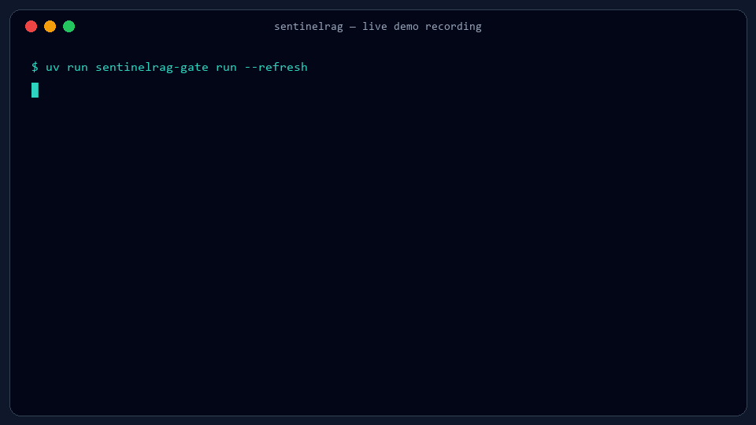
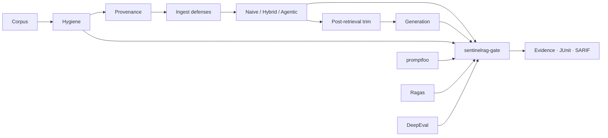

# SentinelRAG

[](https://github.com/prakash888kp/SentinelRAG/actions/workflows/ci.yml)
[](https://github.com/prakash888kp/SentinelRAG/actions/workflows/supply-chain-gate.yml)
[](https://pypi.org/project/sentinelrag/)
[](https://www.python.org/downloads/)
[](LICENSE)

<p align="center">
  
</p>

**RAG supply-chain CI** — fail builds when **retrieval**, **answer grounding**, or **corpus poison / hygiene defenses** regress. Ships evidence (JSON), JUnit, SARIF, an adaptive FastAPI + Qdrant reference stack, and importers for promptfoo / Ragas / DeepEval scores.

**Author:** PRAKASH KUMAR K ([@prakash888kp](https://github.com/prakash888kp)) · **Issues:** [GitHub Issues](https://github.com/prakash888kp/SentinelRAG/issues)

---

## Live demo (recording)

Warm Gemini + real embedder + cross-encoder path captured as a looping terminal recording (~6s):

<p align="center">
  
</p>

Reproduce the same flow on your machine: [docs/DEMO.md](docs/DEMO.md) · refresh the GIF with `uv run python scripts/render_demo_gif.py` (Pillow).

---

## Capability matrix

| Capability | Included |
|---|---|
| Portable evidence | Versioned `sentinelrag-evidence-v1` JSON + [JSON Schemas](schemas/evidence.schema.json) |
| Policy gates | Absolute floors + baseline deltas (`config/gate_policy.yaml`) |
| CI reports | Exit codes + JSON, JUnit XML, SARIF 2.1.0, Markdown summary |
| GitHub integration | Reusable [composite Action](.github/actions/sentinelrag-gate/action.yml) — no hosted account |
| Import promptfoo | `sentinelrag-gate import promptfoo` → evidence |
| Import Ragas | `sentinelrag-gate import ragas` → evidence |
| Import DeepEval | `sentinelrag-gate import deepeval` → evidence |
| Golden retrieval | Mini + public corpora, Recall@K / MRR / hit-rate |
| Hybrid + CE | BM25 + dense fusion + optional MiniLM cross-encoder |
| Agentic RAG | Multi-hop retriever + trajectory metrics |
| Router / Pareto | Complexity policy + cost/latency benchmarks |
| Hygiene scan | Injection / secret-like / PII-like pre-ingest |
| Poison / red-team | Ingest defenses + post-retrieval trim + ASR sweeps |
| Live generation | Gemini 2.5 Flash (CI stays MockLLM) |
| Delivery | pytest, uv, Docker Compose, PyPI `sentinelrag` |

---

## Quick start

### Quality gate (no server or model key)

```bash
pip install sentinelrag
# or from source:
git clone https://github.com/prakash888kp/SentinelRAG.git
cd SentinelRAG
uv sync --extra dev

uv run sentinelrag-gate run --refresh
uv run sentinelrag-gate demo-poison
uv run sentinelrag-gate scan data/public_corpus --fail-on high
```

Artifacts: `.sentinelrag/gate/` · Policy: `config/gate_policy.yaml`

### Import promptfoo evidence

```bash
uv run sentinelrag-gate import promptfoo examples/import_promptfoo/results.json \
  -o build/from-promptfoo.json --source-revision "$GITHUB_SHA"
```

### Import Ragas or DeepEval evidence

```bash
uv run sentinelrag-gate import ragas examples/import_ragas/evaluation-result-records.json \
  --metric faithfulness --metric answer_relevancy -o build/from-ragas.json

uv run sentinelrag-gate import deepeval examples/import_deepeval/report.json \
  -o build/from-deepeval.json
```

See [INTEROPERABILITY.md](docs/INTEROPERABILITY.md).

### Drop into any GitHub repo

```yaml
- uses: prakash888kp/SentinelRAG/.github/actions/sentinelrag-gate@v0.2.1
  with:
    refresh: "true"
```

---

## Why this exists

1. Golden-set **retrieval regression** separate from generation  
2. **CI that fails** on quality drops vs a committed baseline  
3. **Pre-ingest hygiene** before vectors land  
4. **Poison / injection probes** beside eval  
5. **Audit artifacts** — not log spam  



---

## Results

**CI / mock** (`benchmarks/phase1_retrieval.json`): hybrid recall@k **1.0**

**Real embedder** (`phase1_retrieval_real.json`, `bge-small`):

| Corpus | naive@5 | hybrid@5 |
|--------|--------:|---------:|
| mini | **1.0** | **1.0** |
| public | **1.0** | **1.0** |

---

## Docs

| Doc | Topic |
|-----|-------|
| [ARCHITECTURE](docs/ARCHITECTURE.md) | Stack diagram |
| [BENCHMARK](docs/BENCHMARK.md) | How numbers are produced |
| [METRICS](docs/METRICS.md) | Metric dictionary |
| [CI_COOKBOOK](docs/CI_COOKBOOK.md) | Actions recipes |
| [DEPLOYMENT](docs/DEPLOYMENT.md) | Compose + env |
| [INTEROPERABILITY](docs/INTEROPERABILITY.md) | promptfoo / Ragas / DeepEval |
| [ECOSYSTEM](docs/ECOSYSTEM.md) | Related projects |
| [CASE_STUDY](docs/CASE_STUDY.md) | Failure modes we catch |
| [PHASES](docs/PHASES.md) | 0–7 checklist |
| [DEMO](docs/DEMO.md) | Reproduce the live recording |
| [OSS_READINESS](docs/OSS_READINESS.md) | Public launch checklist |
| [PORTFOLIO](docs/PORTFOLIO.md) | Highlights |
| [RELEASE_CHECKLIST](docs/RELEASE_CHECKLIST.md) | Tag / release steps |
| [STORY](docs/STORY.md) · [OWASP map](docs/OWASP_RAG_CI_MAP.md) · [COMPARISON](docs/COMPARISON.md) | Narrative |

Examples: [examples/README.md](examples/README.md) · Schemas: [schemas/](schemas/) · Plans: [docs/superpowers/plans](docs/superpowers/plans/)

---

## License

MIT
