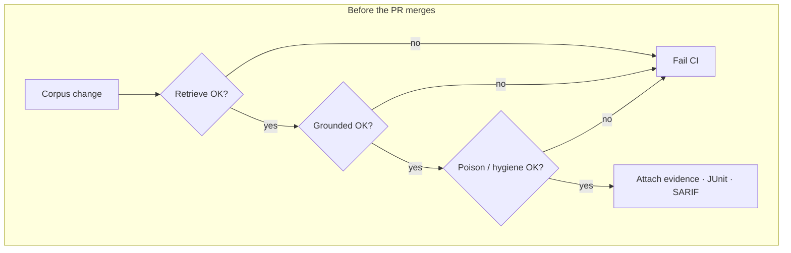
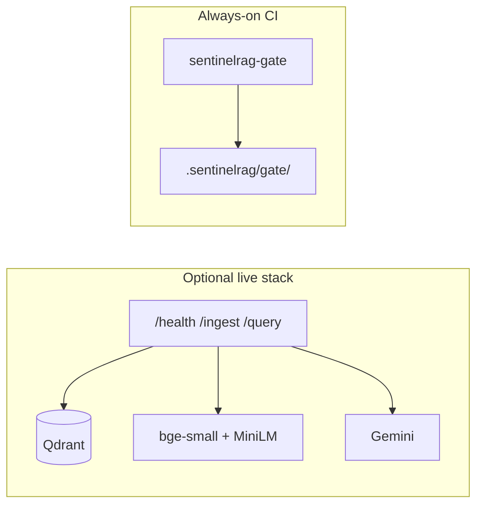

# SentinelRAG


[](https://github.com/prakash888kp/SentinelRAG/actions/workflows/ci.yml)
[](https://github.com/prakash888kp/SentinelRAG/actions/workflows/supply-chain-gate.yml)
[](https://pypi.org/project/sentinelrag/)
[](LICENSE)

**Triple-gate RAG for CI.** Retrieval can look fine in a notebook while a PR quietly tanks recall, ships an ungrounded answer, or lets a poisoned doc into the index. SentinelRAG treats those as **three separate checkpoints** — and fails the build when any one of them slips — with evidence your existing CI already understands (JSON, JUnit, SARIF).

`pip install sentinelrag` · `sentinelrag-gate` CLI · FastAPI + Qdrant reference app · offline mocks in CI · optional Gemini live path

---

## Three checkpoints before merge

| Checkpoint | Catches | How |
|------------|---------|-----|
| **Retrieve** | Silent recall / hit-rate / MRR drops | Golden corpora + hybrid (+ optional cross-encoder) |
| **Ground** | Answers that ignore the context | Versioned judges on a golden set |
| **Defend** | Junk / injection / poison at ingest | Hygiene scan, ingest filters, red-team ASR probes |

Foreign eval scores (promptfoo, Ragas, DeepEval) can feed the same evidence schema — SentinelRAG does not replace those tools; it **unifies their numbers with its own gates**.




The **gate does not need** Gemini, a GPU, or Qdrant. The FastAPI app is there when you want a live stack with citations.



---

## See it query a corpus


Walkthrough: [docs/DEMO.md](docs/DEMO.md)

---

## Install & run the gate

```bash
pip install sentinelrag
# from source:
# uv sync --extra dev

uv run sentinelrag-gate run --refresh
uv run sentinelrag-gate demo-poison
uv run sentinelrag-gate scan data/public_corpus --fail-on high
```

Outputs: `.sentinelrag/gate/` · Policy: `config/gate_policy.yaml`

**Plug into GitHub Actions**

```yaml
- uses: prakash888kp/SentinelRAG/.github/actions/sentinelrag-gate@v0.2.1
  with:
    refresh: "true"
```

**Bring scores from other evaluators**

```bash
uv run sentinelrag-gate import promptfoo examples/import_promptfoo/results.json -o build/art.json
uv run sentinelrag-gate import ragas examples/import_ragas/evaluation-result-records.json \
  --metric faithfulness --metric answer_relevancy -o build/art.json
uv run sentinelrag-gate import deepeval examples/import_deepeval/report.json -o build/art.json
```

Recipes: [CI cookbook](docs/CI_COOKBOOK.md) · Mapping: [Interoperability](docs/INTEROPERABILITY.md)

---

## In the box

- **App** — FastAPI ingest/query, hybrid + agentic retrieval, complexity router  
- **Gate** — policy YAML, baselines, SARIF/JUnit, composite Action  
- **Security loop** — hygiene, provenance SHA, poison benchmark v1  
- **Interop** — promptfoo / Ragas / DeepEval → `sentinelrag-evidence-v1`  
- **Schemas & examples** — [`schemas/`](schemas/) · [`examples/`](examples/)

---

## Benchmarks

All committed under [`benchmarks/`](benchmarks/). Regenerated by the matching `run_*.py` scripts (see [docs/BENCHMARK.md](docs/BENCHMARK.md)).

### Retrieval (Phase 1)

| Suite | Model | naive recall@5 | hybrid recall@5 | hybrid MRR |
|-------|-------|---------------:|----------------:|-----------:|
| Mini corpus (CI) | mock | 0.83 | **1.0** | 0.51 |
| Public corpus (CI) | mock | 0.25 | **1.0** | **1.0** |
| Mini corpus | `bge-small` | **1.0** | **1.0** | 0.69 |
| Public corpus | `bge-small` | **1.0** | **1.0** | **1.0** |

Sources: `phase1_retrieval.json`, `public_retrieval.json`, `phase1_retrieval_real.json`

### RAG quality (Phase 2) · mock judges

| Metric | Value |
|--------|------:|
| mean recall@k | **1.0** |
| mean faithfulness | **0.83** |
| mean relevance | **1.0** |
| golden items | 5 |

Source: `phase2_eval.json`

### Agentic trajectory (Phase 3)

| Metric | Value |
|--------|------:|
| mean trajectory recall | **1.0** |
| mean trajectory usefulness | 0.50 |

Source: `phase3_trajectory.json`

### Pareto · cost / latency / quality

| Strategy | recall@k | cost (USD) | latency (ms) |
|----------|---------:|-----------:|-------------:|
| naive | 0.83 | 0.00005 | 13.9 |
| hybrid | **1.0** | 0.0002 | 5.1 |
| agentic | **1.0** | 0.0012 | 85 |

Sources: `pareto_points.json`, `leaderboard.json`, `pareto_plot.png`

### Poison / red-team

| Probe | Result |
|-------|--------|
| Ingest defense blocked fraction (α sweep) | **1.0** at every α |
| Retrieval ASR @ α=0.5 | 1.0 (attacks still surface without trim) |
| Poison v1 ingest block rate | **0.67** |
| Poison v1 post-retrieval ASR (with trim) | **0.33** |

Sources: `asr_vs_alpha.json`, `asr_vs_alpha.png`, `poison_benchmark_v1.json`

### Hygiene

| Check | Result |
|-------|--------|
| Public/mini hygiene scan | **passed** · 0 findings |

Source: `hygiene_report.json` · manifest: `corpus_manifest.json` · gate bundle: `baseline_evidence.json`

---

## Dig deeper

[Architecture](docs/ARCHITECTURE.md) · [Metrics](docs/METRICS.md) · [Benchmarks](docs/BENCHMARK.md) · [Deployment](docs/DEPLOYMENT.md) · [Poison v1](docs/POISON_BENCHMARK_v1.md) · [OWASP map](docs/OWASP_RAG_CI_MAP.md) · [Story](docs/STORY.md) · [Phases](docs/PHASES.md) · [Comparison](docs/COMPARISON.md) · [Changelog](CHANGELOG.md)

---

## License

[MIT](LICENSE) · [NOTICE](NOTICE)
