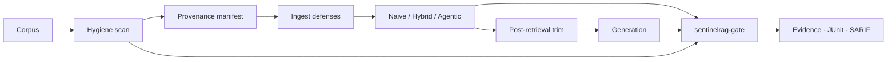

# SentinelRAG

[](https://github.com/prakash888kp/SentinelRAG/actions/workflows/ci.yml)
[](https://github.com/prakash888kp/SentinelRAG/actions/workflows/supply-chain-gate.yml)
[](https://pypi.org/project/sentinelrag/)

**RAG supply-chain CI** — fail builds when **retrieval**, **grounded answers**, or **poison / hygiene defenses** regress. Includes an adaptive FastAPI + Qdrant reference stack.

**Author:** PRAKASH KUMAR K ([@prakash888kp](https://github.com/prakash888kp)) · **Support:** [GitHub Issues](https://github.com/prakash888kp/SentinelRAG/issues)

Narrative: [docs/STORY.md](docs/STORY.md) · Security map: [docs/OWASP_RAG_CI_MAP.md](docs/OWASP_RAG_CI_MAP.md)

---

## Install

```bash
pip install sentinelrag
# or
uv add sentinelrag
```

Dev clone:

```bash
git clone https://github.com/prakash888kp/SentinelRAG.git
cd SentinelRAG
uv sync --extra dev
cp .env.example .env
```

---

## Out of the box (no API keys)

```bash
uv run pytest
uv run sentinelrag-gate run --refresh
uv run sentinelrag-gate demo-poison
uv run sentinelrag-gate scan data/public_corpus --fail-on high
```

| Command | What it does |
|---------|----------------|
| `sentinelrag-gate run` | Policy gate → `evidence.json`, JUnit, SARIF, summary |
| `sentinelrag-gate collect` | Anchor baseline evidence |
| `sentinelrag-gate compare` | Metric deltas between evidence files |
| `sentinelrag-gate scan` | Pre-ingest hygiene (injection / secret-like / PII-like) |
| `sentinelrag-gate demo-poison` | Poison ASR story (ingest + post-retrieval) |

Artifacts: `.sentinelrag/gate/` · Policy: `config/gate_policy.yaml`

### Drop into any GitHub repo

```yaml
- uses: prakash888kp/SentinelRAG/.github/actions/sentinelrag-gate@v0.2.0
  with:
    refresh: "true"
```

---

## What problem this solves

Teams on Reddit / LocalLLaMA / RAG ops repeatedly ask for:

1. **Golden-set retrieval regression** (recall / hit-rate / MRR) separate from generation  
2. **CI that fails on quality drops** vs a committed baseline  
3. **Pre-ingest hygiene** before vectors land in the index  
4. **Poison / indirect injection probes** in the same pipeline as eval  
5. **Audit artifacts** (JSON evidence, JUnit, SARIF) — not log spam  

SentinelRAG ships that stack **offline by default** (MockLLM / MockEmbedder).



---

## Results (mock, seed 42)

Committed under `benchmarks/`:

- Mini + public corpus: hybrid **recall@k = 1.0** (also hit-rate + latency)  
- Phase 2 mock judges: faithfulness / relevance gated  
- Poison v1 + red-team defense probes  
- Hygiene report + corpus SHA-256 manifest  

---

## Layout

```
src/sentinelrag/
  api/           FastAPI service
  ingest/        loaders, chunking, hygiene, provenance, filters
  retrieval/     BM25, hybrid, agentic, stores
  router/        complexity + cost policy
  eval/          metrics, judges, golden I/O, latency
  redteam/       attacks, defenses, post-retrieval, harness
  gate/          evidence, policy, CLI, SARIF/JUnit
  generation/    MockLLM + providers
  observability/ cost + OTel
benchmarks/      reproducible JSON + plots
config/          eval_thresholds.yaml · gate_policy.yaml
data/            mini_corpus · public_corpus · golden.jsonl
```

---

## API demo

```bash
docker compose up --build -d
curl -s http://127.0.0.1:8000/health
curl -s -X POST http://127.0.0.1:8000/query \
  -H "Content-Type: application/json" \
  -d '{"query":"What is triple-gate RAG?", "strategy":"auto"}'
```

---

## Docs

[CONTRIBUTING](CONTRIBUTING.md) · [SECURITY](SECURITY.md) · [CHANGELOG](CHANGELOG.md) · [COMPARISON](docs/COMPARISON.md) · [POISON_BENCHMARK_v1](docs/POISON_BENCHMARK_v1.md)

## License

MIT
