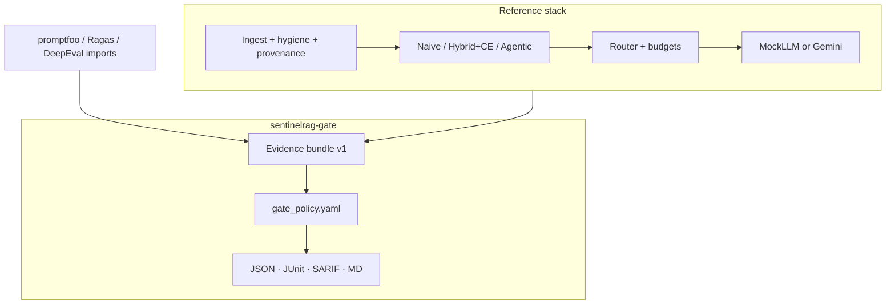

# Architecture

SentinelRAG is a **reference RAG app** plus a **supply-chain CI gate**.

| Layer | Module | Notes |
|-------|--------|-------|
| API | `sentinelrag.api` | FastAPI `/health` `/ingest` `/query` `/eval/run` |
| Ingest | `ingest/` | Chunking, filters, hygiene scan, provenance SHA |
| Retrieval | `retrieval/` | BM25, dense, hybrid fusion, cross-encoder, agentic hops |
| Eval | `eval/` | Recall/MRR/hit-rate, judges, golden I/O |
| Red-team | `redteam/` | Poison families + defenses + harness |
| Gate | `gate/` | Evidence, policy, importers, reports, CLI |
| Schemas | `schemas/` | JSON Schema for evidence + policy |

CI never requires GPU or API keys. Live demos optionally use Gemini + `uv sync --extra ml`.
